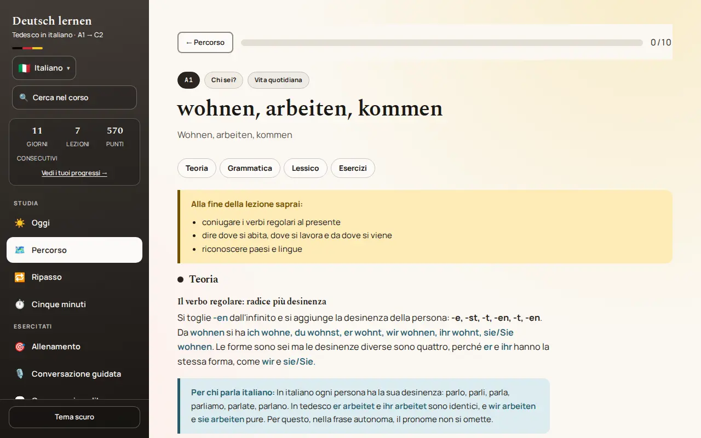
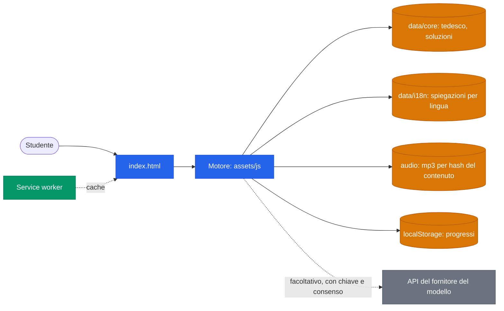

[English](./README.md) | **Italiano**

# Deutsch lernen

Un corso di tedesco da A1 a C2 che gira interamente nel browser, con spiegazioni in italiano, inglese, spagnolo, francese o polacco.

Corso online: <https://andreabonn.github.io/lerne-deutsch/>. Lo apri e cominci una lezione: non serve registrarsi.


## Che cos'è

Deutsch lernen insegna il tedesco standard (`de-DE`) con grammatica, esercizi, audio registrato, ripasso a ripetizione dilazionata e una simulazione d'esame. Chi studia sceglie la lingua delle spiegazioni, e le note che confrontano il tedesco con quella lingua sono scritte apposta per ciascuna, non tradotte da una delle altre.

È un sito statico: HTML, CSS e JavaScript semplice, senza backend, senza build step e senza dipendenze a runtime. I progressi restano nel browser di chi studia. Il corso funziona da un web server, installato come app, offline dopo la prima visita e anche aperto direttamente dal disco (`file://`).

Il corso nasce come fork di un corso di italiano (`versione-statica`) e ne condivide il motore. Le correzioni al motore comune arrivano prima lì e passano qui con un cherry-pick.

## In pratica



Cosa contiene oggi il corso, secondo `node scripts/baseline.mjs`:

| Contenuto | Quantità |
|---|---|
| Unità / lezioni / esercizi | 37 / 170 / 1735 |
| Voci di lessico / conversazioni guidate / argomenti di grammatica | 1592 / 14 / 55 |
| Letture brevi / compiti di scrittura / serie di coppie minime | 24 / 6 / 4 |
| Testi della biblioteca (400-800 parole ciascuno) | 6 testi, 3411 parole |
| Frasi registrate (voci neurali `de-DE-KatjaNeural` e `de-DE-ConradNeural`) | 4248 file mp3 |
| Lingue dell'interfaccia | 5, con 962 chiavi ciascuna |

## Manuale utente

Il manuale spiega ogni schermata a chi studia, senza presupporre competenze tecniche:

- [User manual (English)](./docs/USER-MANUAL.md)
- [Manuale utente (italiano)](./docs/MANUALE-UTENTE.md)

## Funzionalità

- **Lezioni**: teoria, tabella di grammatica, lessico, dialogo, nota di cultura ed esercizi. Il corso ha 14 tipi di esercizio: scelta multipla, scelta di più risposte, vero/falso, abbinamento, articoli, coppie minime, completamento, traduzione, testo da completare, costruzione della frase, coniugazione, ascolto, pronuncia e conversazione. Una lezione è superata con il 70% di risposte corrette.
- **Oggi**: una sessione di dieci minuti costruita per te con i tuoi errori, un allenamento sull'argomento che va peggio e le carte in scadenza.
- **Ripasso**: carte di lessico programmate con FSRS, più un quaderno degli errori che ti ripropone esattamente l'esercizio sbagliato, etichettato con l'argomento di grammatica.
- **Cinque minuti**: una sessione di carte che si ferma dopo cinque minuti o venti carte.
- **Allenamento**: esercizi generati da regole (numeri, orari, date, articoli, casi, preposizioni, ausiliare del Perfekt), quindi non finiscono mai.
- **Parlato e ascolto**: conversazioni guidate a voce, shadowing, esercizi di velocità e coppie minime, tutti su audio registrato.
- **Lettura e scrittura**: letture graduate, una biblioteca di testi lunghi con segnalibro per riprendere, e compiti di scrittura controllati sulle costruzioni che hai usato.
- **Esame**: una simulazione non ufficiale nello stile del Goethe-Zertifikat B1, con due prove complete. Dà un punteggio solo a lettura e ascolto; non è affiliata al Goethe-Institut e non usa suo materiale.
- **Consultazione**: programma completo di grammatica, un coniugatore per qualsiasi verbo, il tuo lessico salvato, i falsi amici e una schermata di copertura che mostra quanta parte del tedesco più frequente conosci già.
- **Controllo facoltativo con un modello**: con una chiave API che hai già (Google Gemini, Groq, OpenAI o Anthropic Claude) e il tuo consenso esplicito, un modello dà un secondo parere sulle risposte che il corso ha rifiutato. Può solo trasformare un rifiuto in un'accettazione, mai il contrario.
- **I tuoi dati restano tuoi**: backup e ripristino su file, esportazione e importazione di un mazzo Anki, un promemoria per il calendario (`.ics`), nessun account.

## Stack tecnologico

| Area | Cosa si usa |
|---|---|
| Applicazione | HTML, CSS, JavaScript semplice (script classici, niente moduli, niente framework) |
| Offline e installazione | Service worker (`sw.js`), web app manifest |
| Memorizzazione | `localStorage` nel browser di chi studia |
| Font | Spectral, Manrope, JetBrains Mono, ospitati in `assets/fonts/` |
| Generazione dell'audio | Script Python eseguito con `uv` (`scripts/build_audio.py`) |
| Strumenti (solo sviluppo) | Test runner di Node.js, Playwright, ESLint, axe-core |
| CI e hosting | GitHub Actions, GitHub Pages |

## Architettura



I contenuti del corso stanno su due livelli. `data/core/` contiene tutto ciò che è in tedesco e tutto ciò che verifica una risposta; `data/i18n/<lingua>/` contiene il testo che chi studia legge nella propria lingua. Il motore li unisce per indice quando carica un livello, quindi una nuova lingua delle spiegazioni è una cartella in più e nessuna nuova registrazione. I file audio prendono il nome da un hash della frase che pronunciano, così le frasi invariate restano sullo stesso file tra una rigenerazione e l'altra.

L'unico traffico di rete verso l'esterno del sito è il controllo facoltativo con un modello, e solo se chi studia ha incollato una chiave e dato il consenso.

## Prerequisiti

Per usare il corso: un browser recente. Nient'altro.

Per svilupparlo e testarlo:

- Node.js 24 (la versione usata in CI)
- [uv](https://docs.astral.sh/uv/), solo per rigenerare i file audio

## Esecuzione locale

1. Clona il repository:
   ```bash
   git clone https://github.com/AndreaBonn/lerne-deutsch.git
   cd lerne-deutsch
   ```
2. Servilo con il server incluso, che non usa mai la cache:
   ```bash
   node scripts/serve.mjs 8080
   ```
3. Apri <http://localhost:8080/>.

Funziona anche aprire `index.html` direttamente dal disco. La modalità offline e il controllo facoltativo con un modello richiedono `http(s)`, quindi lì sono disattivati.

Non ci sono file di configurazione né variabili d'ambiente. Lingua delle spiegazioni, voce, velocità del parlato, ritmo del ripasso e chiavi API facoltative si impostano nella schermata Impostazioni.

## Sviluppo

Prima installa gli strumenti di test:

```bash
npm ci
npx playwright install chromium
```

| Comando | Cosa fa |
|---|---|
| `npm run lint` | ESLint, solo regole di correttezza |
| `node scripts/validate.mjs [it\|en\|es\|fr\|pl]` | Controlla i dati del corso dopo l'unione: id duplicati, esercizi completi, lunghezza dei testi della biblioteca |
| `node scripts/parity.mjs` | Controlla che ogni lingua abbia la stessa forma di quella italiana |
| `node scripts/check_precache.mjs` | Controlla che il service worker metta in cache tutto ciò che carica `index.html` |
| `node scripts/check_swversion.mjs [--napraw]` | Controlla (o riscrive) l'impronta del contenuto nella versione del service worker |
| `npm test` | Test unitari del motore (`node:test`) |
| `npm run test:mutations` | Controllo a mutazioni: rompe una decisione alla volta e si aspetta che un test fallisca |
| `npm run test:dom` | Test nel browser con Playwright |
| `npm run test:all` | Test unitari, a mutazioni e nel browser |
| `npm run coverage` | Copertura del motore misurata dai test unitari |

### Aggiungere contenuti e audio

```bash
node scripts/extract_strings.mjs           # elenca ogni frase che richiede una registrazione
uv run --script scripts/build_audio.py     # genera solo gli mp3 mancanti
npm run audio:prune                        # elenca gli mp3 orfani; li cancella solo con --apply
```

Dopo aver aggiunto un file in `assets/js/` o `data/core/`, aggiungilo a `PRECACHE` in `sw.js` ed esegui `node scripts/check_swversion.mjs --napraw`.

## Struttura del repository

```text
.
├── index.html            # l'intera interfaccia dell'applicazione
├── sw.js                 # service worker: cache offline e avviso di aggiornamento
├── 404.html              # pagina per gli indirizzi sconosciuti su GitHub Pages
├── assets/
│   ├── js/               # motore: un file, una responsabilità, un globale
│   ├── css/              # stili
│   ├── fonts/            # font ospitati in locale
│   ├── icons/, og/       # icone dell'app e immagine di anteprima dei link
├── data/
│   ├── core/             # dati del corso neutri rispetto alla lingua (tedesco, soluzioni)
│   ├── i18n/             # spiegazioni e testi dell'interfaccia, una cartella per lingua
│   └── audio-index.js    # hash ordinati di tutte le frasi registrate
├── audio/                # registrazioni mp3, nominate per hash del contenuto
├── scripts/              # validazione, audio, gate di CI e script di supporto
├── tests/
│   ├── unit/             # test del motore in una sandbox node:vm
│   └── dom/              # test nel browser con Playwright
├── docs/                 # manuali utente, informativa privacy, screenshot
└── badges/               # dati dei badge scritti dalla CI
```

## Testing

I test unitari eseguono i veri file del motore dentro una sandbox `node:vm`, con orologio e `localStorage` sostituiti (`tests/unit/`). I test nel browser girano con Playwright su `scripts/serve.mjs` (`tests/dom/`) e coprono il routing, ogni tipo di esercizio, la correzione, il contrasto per l'accessibilità in entrambi i temi, il backup, il service worker e la Content Security Policy. Il controllo a mutazioni in `scripts/mutations.mjs` verifica che i test unitari falliscano quando una decisione del motore viene rotta.

## Deploy e CI/CD

`.github/workflows/ci.yml` gira a ogni push e pull request, dai controlli più economici ai più costosi: lint, validazione dei dati, avanzamento del porting, parità tra le lingue, elenco di precache, tag di anteprima dei link, pagina 404, versione del service worker, test unitari, controllo a mutazioni, copertura del motore (minimo 99%) e test nel browser. Su `main` committa anche i dati dei badge di test e copertura in `badges/`.

Il sito è pubblicato con GitHub Pages su <https://andreabonn.github.io/lerne-deutsch/>. L'indirizzo è definito in un solo punto, il campo `homepage` di `package.json`.

## Privacy

Il corso non ha account, statistiche di utilizzo né un server proprio. Cosa memorizza, cosa può uscire dal dispositivo (il riconoscimento vocale del browser, il controllo facoltativo con un modello, i log del servizio di hosting) e come annullarlo è spiegato nella schermata Privacy dell'app. Il testo di riferimento è [docs/PRIVACY.it.md](./docs/PRIVACY.it.md).

## Sicurezza

Per segnalare una vulnerabilità, consulta [SECURITY.it.md](./SECURITY.it.md).

## Licenza

Il repository è coperto da due licenze, entrambe descritte in [LICENSE](./LICENSE):

- Codice (`assets/js/`, `assets/css/`, `scripts/`, `tests/`, `sw.js`, `index.html`, configurazione): MIT.
- Contenuti del corso (`data/`, `audio/`, `docs/`): CC BY-SA 4.0, vedi [LICENSE-CONTENT](./LICENSE-CONTENT).
- Font in `assets/fonts/`: SIL Open Font License, dei rispettivi autori.

## Supporta il progetto

Se il corso ti è utile, una stella su [GitHub](https://github.com/AndreaBonn/lerne-deutsch) aiuta altri a trovarlo. Le donazioni passano dal link nel pulsante Sponsor del repository.
