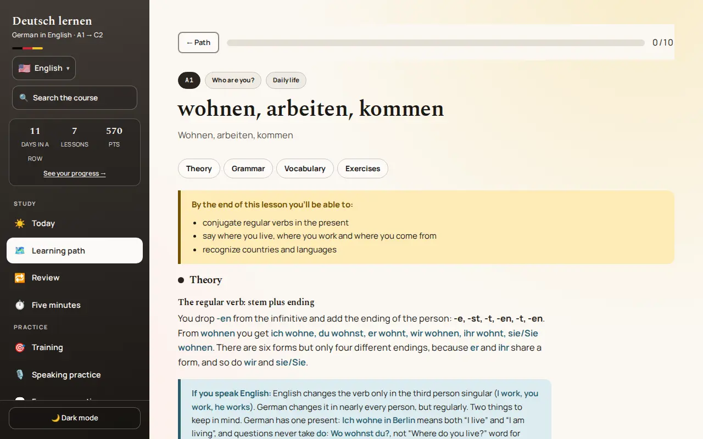
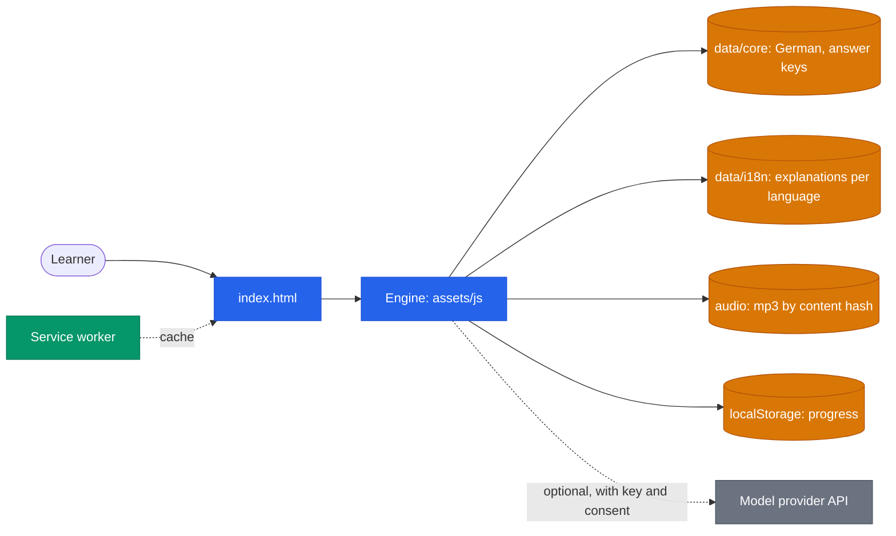

**English** | [Italiano](./README.it.md)

# Deutsch lernen

A German course from A1 to C2 that runs entirely in the browser, with explanations in Italian, English, Spanish, French or Polish.

Live course: <https://andreabonn.github.io/lerne-deutsch/>. Open it and start a lesson; there is nothing to sign up for.


## What it is

Deutsch lernen teaches standard German (`de-DE`) with grammar, exercises, recorded audio, spaced-repetition review and an exam simulation. The learner picks the language of the explanations, and the notes that compare German with that language are written for each language, not translated from one of them.

It is a static site: HTML, CSS and plain JavaScript, no backend, no build step and no runtime dependency. Progress is stored in the learner's browser. The course works from a web server, installed as an app, offline after the first visit, and also opened straight from disk (`file://`).

The course was forked from an Italian course (`versione-statica`) and shares its engine. Fixes to the shared engine land there first and come here by cherry-pick.

## In practice



What is in the course today, as counted by `node scripts/baseline.mjs`:

| Content | Count |
|---|---|
| Units / lessons / exercises | 37 / 170 / 1735 |
| Vocabulary entries / guided conversations / grammar topics | 1592 / 14 / 55 |
| Short readings / writing tasks / minimal-pair sets | 24 / 6 / 4 |
| Library texts (400-800 words each) | 6 texts, 3411 words |
| Recorded sentences (neural voices `de-DE-KatjaNeural` and `de-DE-ConradNeural`) | 4248 mp3 files |
| Interface languages | 5, 962 keys each |

## User manual

The manual explains every screen for learners, without technical background:

- [User manual (English)](./docs/USER-MANUAL.md)
- [Manuale utente (italiano)](./docs/MANUALE-UTENTE.md)

## Features

- **Lessons**: theory, grammar table, vocabulary, dialogue, culture note and exercises. The course has 14 exercise types: multiple choice, pick several, true/false, matching, articles, minimal pairs, gap fill, translation, text cloze, sentence building, conjugation, listening, pronunciation and conversation. A lesson is passed at 70% correct answers.
- **Today**: a ten-minute session built for you from your mistakes, a drill on your weakest topic and the cards that are due.
- **Review**: vocabulary cards scheduled with FSRS, plus a mistake notebook that brings back the exact exercise you got wrong, labelled with its grammar topic.
- **Five minutes**: a card session that stops after five minutes or twenty cards.
- **Training**: exercises generated from rules (numbers, times, dates, articles, cases, prepositions, Perfekt auxiliaries), so they never run out.
- **Speaking and listening**: guided spoken conversations, shadowing, speed practice and minimal pairs, all on recorded audio.
- **Reading and writing**: graded readings, a library of longer texts with a resume marker, and writing tasks checked on the constructions you used.
- **Exam**: an unofficial simulation in the style of Goethe-Zertifikat B1, with two complete model tests. It scores reading and listening only; it is not affiliated with the Goethe-Institut and uses none of its material.
- **Reference**: full grammar syllabus, a conjugator for any verb, your saved vocabulary, false friends, and a coverage screen that shows how much of frequent German you already know.
- **Optional model checking**: with an API key you already own (Google Gemini, Groq, OpenAI or Anthropic Claude) and your explicit consent, a model gives a second opinion on answers the course rejected. It can only turn a rejection into an acceptance, never the other way round.
- **Your data stays with you**: backup and restore as a file, Anki deck export and import, a calendar reminder (`.ics`), and no account.

## Tech stack

| Area | What is used |
|---|---|
| Application | HTML, CSS, plain JavaScript (classic scripts, no modules, no framework) |
| Offline and install | Service worker (`sw.js`), web app manifest |
| Storage | `localStorage` in the learner's browser |
| Fonts | Spectral, Manrope, JetBrains Mono, self-hosted in `assets/fonts/` |
| Audio generation | Python script run with `uv` (`scripts/build_audio.py`) |
| Tooling (development only) | Node.js test runner, Playwright, ESLint, axe-core |
| CI and hosting | GitHub Actions, GitHub Pages |

## Architecture



Course content has two layers. `data/core/` holds everything in German and everything that checks an answer; `data/i18n/<lang>/` holds the text the learner reads in their own language. The engine merges them by index when a level loads, so a new explanation language is one new folder and no new recordings. Audio files are named by a hash of the sentence they speak, which keeps unchanged sentences on the same file across rebuilds.

The only network traffic outside the site itself is the optional model check, and only when the learner has pasted a key and given consent.

## Prerequisites

To use the course: a recent browser. Nothing else.

To develop and test it:

- Node.js 24 (the version CI uses)
- [uv](https://docs.astral.sh/uv/), only to regenerate the audio files

## Running locally

1. Clone the repository:
   ```bash
   git clone https://github.com/AndreaBonn/lerne-deutsch.git
   cd lerne-deutsch
   ```
2. Serve it with the bundled server, which never caches:
   ```bash
   node scripts/serve.mjs 8080
   ```
3. Open <http://localhost:8080/>.

Opening `index.html` directly from disk also works. Offline mode and the optional model check need `http(s)`, so they are switched off there.

There is no configuration file and no environment variable. Explanation language, voice, speech rate, review rhythm and optional API keys are set by the learner in the Settings screen.

## Development

Install the test toolchain first:

```bash
npm ci
npx playwright install chromium
```

| Command | What it does |
|---|---|
| `npm run lint` | ESLint, correctness rules only |
| `node scripts/validate.mjs [it\|en\|es\|fr\|pl]` | Checks course data after merging: duplicate ids, complete exercises, library text length |
| `node scripts/parity.mjs` | Checks that every language overlay has the same shape as the Italian one |
| `node scripts/check_precache.mjs` | Checks that the service worker caches everything `index.html` loads |
| `node scripts/check_swversion.mjs [--napraw]` | Checks (or rewrites) the content fingerprint in the service worker version |
| `npm test` | Unit tests of the engine (`node:test`) |
| `npm run test:mutations` | Mutation check: breaks one decision at a time and expects a test to fail |
| `npm run test:dom` | Browser tests with Playwright |
| `npm run test:all` | Unit, mutation and browser tests |
| `npm run coverage` | Engine coverage measured from the unit tests |

### Adding content and audio

```bash
node scripts/extract_strings.mjs           # list every sentence that needs a recording
uv run --script scripts/build_audio.py     # generate only the missing mp3 files
npm run audio:prune                        # list orphan mp3 files; deletes only with --apply
```

After adding a file to `assets/js/` or `data/core/`, add it to `PRECACHE` in `sw.js` and run `node scripts/check_swversion.mjs --napraw`.

## Repository structure

```text
.
├── index.html            # the whole application shell
├── sw.js                 # service worker: offline cache and update notice
├── 404.html              # page for unknown addresses on GitHub Pages
├── assets/
│   ├── js/               # engine: one file, one responsibility, one global
│   ├── css/              # styles
│   ├── fonts/            # self-hosted fonts
│   ├── icons/, og/       # app icons and the link preview image
├── data/
│   ├── core/             # language-neutral course data (German, answer keys)
│   ├── i18n/             # explanations and interface text, one folder per language
│   └── audio-index.js    # sorted hashes of every recorded sentence
├── audio/                # mp3 recordings, named by content hash
├── scripts/              # validation, audio, CI gates and helper scripts
├── tests/
│   ├── unit/             # engine tests in a node:vm sandbox
│   └── dom/              # Playwright browser tests
├── docs/                 # user manuals, privacy notice, screenshots
└── badges/               # badge data written by CI
```

## Testing

Unit tests run the real engine files inside a `node:vm` sandbox with time and `localStorage` replaced (`tests/unit/`). Browser tests run with Playwright against `scripts/serve.mjs` (`tests/dom/`) and cover routing, every exercise type, grading, accessibility contrast in both themes, backup, the service worker and the Content Security Policy. The mutation check in `scripts/mutations.mjs` verifies that the unit tests fail when a decision in the engine is broken.

## Deployment and CI/CD

`.github/workflows/ci.yml` runs on every push and pull request, cheapest checks first: lint, data validation, porting progress, language parity, precache list, link-preview tags, the 404 page, service worker version, unit tests, mutation check, engine coverage (minimum 99%) and browser tests. On `main` it also commits the test and coverage badge data in `badges/`.

The site is published with GitHub Pages at <https://andreabonn.github.io/lerne-deutsch/>. The address is set in one place, the `homepage` field of `package.json`.

## Privacy

The course has no account, no analytics and no server of its own. What it stores, what can leave the device (speech recognition in the browser, the optional model check, the hosting provider's logs) and how to undo it is explained in the in-app Privacy screen. The source text is [docs/PRIVACY.it.md](./docs/PRIVACY.it.md) (Italian).

## Security

To report a vulnerability, see [SECURITY.md](./SECURITY.md).

## License

Two licenses cover this repository, both in [LICENSE](./LICENSE):

- Code (`assets/js/`, `assets/css/`, `scripts/`, `tests/`, `sw.js`, `index.html`, configuration): MIT.
- Course content (`data/`, `audio/`, `docs/`): CC BY-SA 4.0, see [LICENSE-CONTENT](./LICENSE-CONTENT).
- Fonts in `assets/fonts/`: SIL Open Font License, from their authors.

## Support the project

If the course helps you, a star on [GitHub](https://github.com/AndreaBonn/lerne-deutsch) helps others find it. Donations go through the link in the repository's Sponsor button.
