[English](./USER-MANUAL.md) | **Italiano**

# Deutsch lernen: manuale utente

Questo manuale è per chi usa il corso per imparare il tedesco. Non servono conoscenze tecniche. Ogni nome in **grassetto** è l'etichetta che vedi sullo schermo quando il corso è impostato con le spiegazioni in italiano.

Il corso si trova su <https://andreabonn.github.io/lerne-deutsch/>.

## Indice

- [Cosa ti serve](#cosa-ti-serve)
- [Il primo avvio](#il-primo-avvio)
- [Come orientarsi](#come-orientarsi)
- [Come è organizzato il corso](#come-è-organizzato-il-corso)
- [Dentro una lezione](#dentro-una-lezione)
- [Come vengono controllate le risposte](#come-vengono-controllate-le-risposte)
- [Audio e voce](#audio-e-voce)
- [Studia](#studia)
- [Esercitati](#esercitati)
- [Consulta](#consulta)
- [Il tuo spazio](#il-tuo-spazio)
- [Mettere al sicuro i progressi](#mettere-al-sicuro-i-progressi)
- [Uso offline, installazione e promemoria](#uso-offline-installazione-e-promemoria)
- [Facoltativo: verifica delle risposte con un modello](#facoltativo-verifica-delle-risposte-con-un-modello)
- [La privacy in breve](#la-privacy-in-breve)
- [Quando qualcosa non funziona](#quando-qualcosa-non-funziona)

## Cosa ti serve

- Un browser recente su computer, tablet o telefono. Chrome, Edge e Safari dalla versione 16 supportano tutte le funzioni, compresi gli esercizi di pronuncia. Gli altri browser fanno girare tutto il corso; dove manca il riconoscimento vocale, gli esercizi parlati passano alla scrittura.
- Cuffie o altoparlanti per l'audio.
- Un microfono, solo per gli esercizi parlati.

Non c'è un account da creare e non si paga nulla. I progressi vengono salvati nel browser che stai usando, sul dispositivo che stai usando.

## Il primo avvio

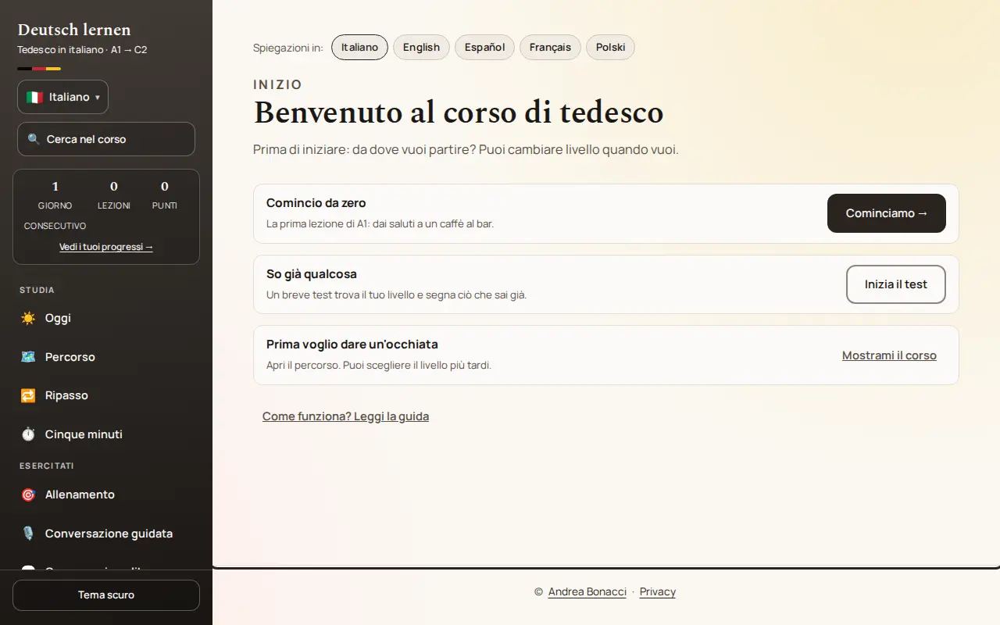

La prima volta che apri il corso trovi tre scelte:

- **Comincio da zero** apre la prima lezione di A1: dai saluti a un caffè al bar.
- **So già qualcosa** avvia un breve test di livello. Ha circa 18 domande in tre giri e salta da un livello all'altro invece di percorrerli tutti, quindi finisce in fretta. Alla fine propone un livello: **Comincia da …** segna come fatte le lezioni dei livelli inferiori (senza punti, perché non le hai svolte), mentre **Preferisco iniziare da zero** lascia tutto aperto. Puoi rifare il test più tardi dalle **Impostazioni**.
- **Prima voglio dare un'occhiata** apre il percorso senza scegliere nulla.

In cima alla schermata di benvenuto scegli la **lingua delle spiegazioni**: Italiano, English, Español, Français o Polski. Il tedesco è sempre la lingua che impari; questa scelta cambia solo la lingua di spiegazioni, traduzioni e interfaccia. Puoi cambiarla quando vuoi con il pulsante della lingua in cima alla barra laterale, e i progressi restano gli stessi.

## Come orientarsi

Su un computer la barra laterale a sinistra contiene tutto. In alto: il nome del corso, il pulsante della lingua, **Cerca nel corso** e un riquadro con tre numeri (giorni consecutivi, lezioni, punti) che apre **Progressi**. Sotto ci sono quattro gruppi di schermate: **Studia**, **Esercitati**, **Consulta** e **Il tuo spazio**. In fondo, **Tema scuro** cambia i colori.

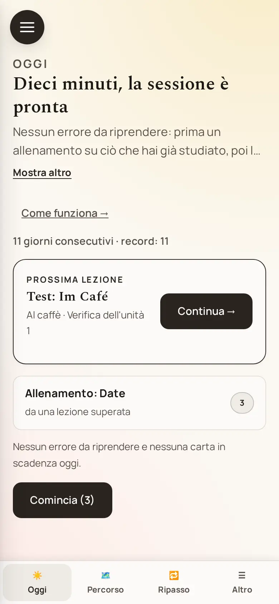

Su un telefono la barra laterale è nascosta. Una barra in fondo allo schermo dà accesso a **Oggi**, **Percorso** e **Ripasso**; **Altro** apre il menu completo.

**Cerca nel corso** cerca fra i titoli delle lezioni, il lessico, le voci di grammatica e le conversazioni, in tedesco o in italiano, con o senza accenti e umlaut.

## Come è organizzato il corso

Il corso va da A1 a C2, i sei livelli del Quadro comune europeo. Ogni livello è diviso in unità, e ogni unità in lezioni. L'ultima voce di un'unità è un test che copre tutta l'unità, non solo l'ultima lezione.

La grammatica è cumulativa: A2 dà per scontato A1, B1 dà per scontato A2. Niente ti impedisce di aprire una lezione più avanti, ma da lì in poi le lezioni non rispiegano ciò che è venuto prima.

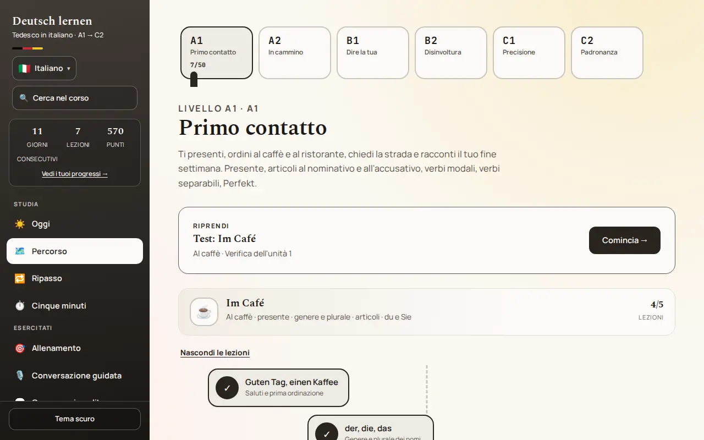

**Percorso** mostra tutti i livelli, le unità e le lezioni, con i tuoi progressi su ciascuno. Una lezione spuntata è superata. Un riquadro in cima indica la prossima lezione da fare, con un pulsante per aprirla.

## Dentro una lezione

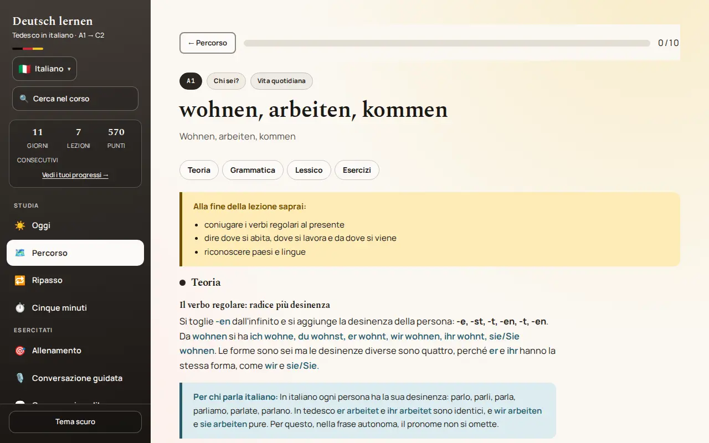

Ogni lezione ha le stesse parti, raggiungibili dai pulsanti sotto il titolo: **Teoria**, **Grammatica**, **Lessico**, **Esercizi**, più un dialogo e una nota di cultura.

- **Teoria** spiega l'argomento. I riquadri azzurri confrontano il tedesco con la lingua delle spiegazioni: sono scritti a parte per ogni lingua, perché la difficoltà di chi parla italiano non è quella di chi parla polacco o inglese.
- **Grammatica** contiene una tabella ed esempi. La teoria resta sulla pagina, quindi puoi tornarci mentre fai gli esercizi.
- **Lessico** elenca le parole della lezione con traduzione ed esempio. Il pulsante con l'altoparlante fa sentire la parola. **+ Ripasso** aggiunge una parola al tuo mazzo di ripasso; **Aggiungi tutto al ripasso** aggiunge tutte le parole della lezione in un colpo.
- **Esercizi** chiudono la lezione, numerati in alto così vedi quanti ne mancano.

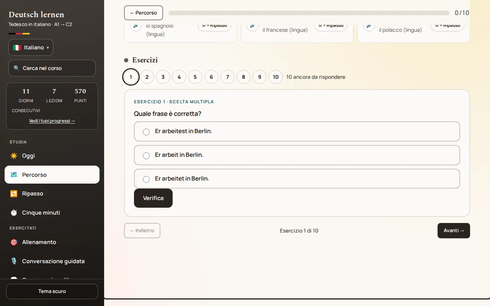

Rispondi e premi **Verifica**. **Avanti** e **Indietro** passano da un esercizio all'altro. Una lezione è superata dal **70 per cento** di risposte corrette. Sotto quella soglia resta aperta e puoi rifarla: non si perde nulla e il punteggio riparte da capo.

Ogni risposta sbagliata apre una scheda nel quaderno degli errori, che ti torna davanti in **Ripasso**. Non devi annotare niente.

### I tipi di esercizio

| Sullo schermo | Cosa fai |
|---|---|
| scelta multipla | scegli la risposta giusta |
| più risposte | selezioni tutte le risposte corrette |
| vero o falso | decidi se un'affermazione su un testo è vera (nelle letture) |
| abbinamento | abbini espressioni tedesche e significati |
| articoli | scegli `der`, `die` o `das`, o l'articolo nel caso giusto |
| coppia minima | senti una di due parole simili e dici quale era |
| completa la frase | scrivi la parola che manca |
| completa il testo | riempi più spazi in un breve testo |
| traduzione | traduci verso il tedesco o dal tedesco |
| ricostruisci la frase | metti in ordine le tessere con le parole |
| coniugazione | scrivi le forme di un verbo in un tempo dato |
| ascolto | ascolti e scrivi ciò che senti |
| pronuncia | leggi una frase ad alta voce nel microfono |
| conversazione | dici la tua battuta in un breve dialogo |

## Come vengono controllate le risposte

Il corso confronta ciò che scrivi con la risposta attesa.

- La maiuscola a inizio frase non è obbligatoria.
- Scrivere `ae`, `oe`, `ue` o `ss` al posto di `ä`, `ö`, `ü` o `ß`, oppure un sostantivo in minuscolo (`die strasse` per `die Straße`), vale come **quasi giusto**: compare l'invito a controllare la grafia e puoi riprovare.
- **Un umlaut mancante è un errore**. `Madchen` non è `Mädchen`, come `schon` non è `schön`. Scrivi l'umlaut, oppure la trascrizione qui sopra.
- Dove esiste una forma sintetica del Konjunktiv II (`stünde`, `führe`), viene accettata anche se la tabella mostra la forma con `würde`.

### Scrivere i caratteri tedeschi

Quando un campo attende una risposta in tedesco, sotto compare una fila di pulsanti che inserisce `ä ö ü ß Ä Ö Ü`. Sul telefono puoi anche tenere premuta la vocale sulla tastiera.

## Audio e voce

Le frasi del corso sono registrazioni fatte con due voci neurali tedesche: una per chi parla di più e una per l'altra persona nei dialoghi e nelle conversazioni. Le forme che non sono state registrate (per esempio alcune forme del coniugatore) vengono lette dalla voce del dispositivo, che può suonare meccanica, soprattutto su Linux.

Nelle **Impostazioni** scegli il tipo di voce, la velocità e se l'audio parte da solo negli esercizi.

Gli esercizi parlati usano il riconoscimento vocale integrato nel browser. In Chrome ed Edge il browser invia la tua voce ai server del suo produttore per trasformarla in testo; per questo il corso chiede il consenso prima della prima registrazione. Senza consenso gli esercizi parlati non registrano nulla e puoi scrivere la risposta. Il consenso si ritira nelle **Impostazioni** in qualsiasi momento.

## Studia

### Oggi

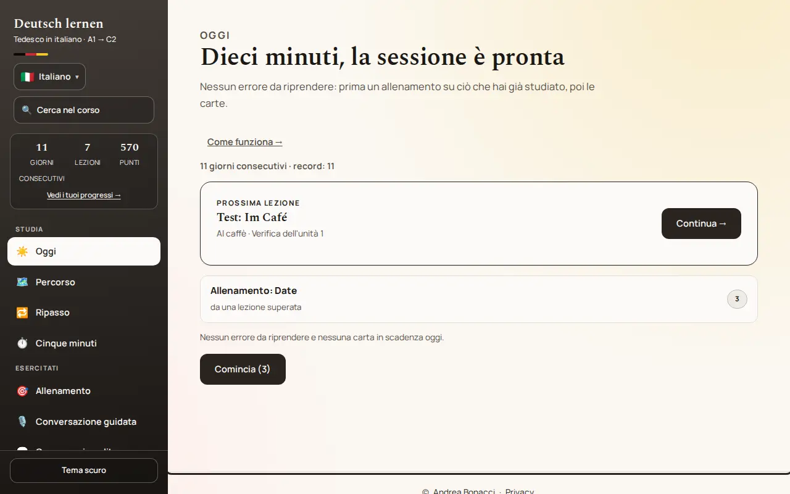

**Oggi** prepara per te una sessione di dieci minuti: prima i tuoi errori, poi un allenamento sull'argomento che va peggio, poi le carte in scadenza. Mostra anche la prossima lezione con il pulsante **Continua**. Usala nei giorni in cui non vuoi decidere cosa studiare. La sessione ha sempre qualcosa dentro, perché gli esercizi generati non finiscono mai.

### Percorso

Tutti i livelli, le unità e le lezioni. Vedi [Come è organizzato il corso](#come-è-organizzato-il-corso).

### Ripasso

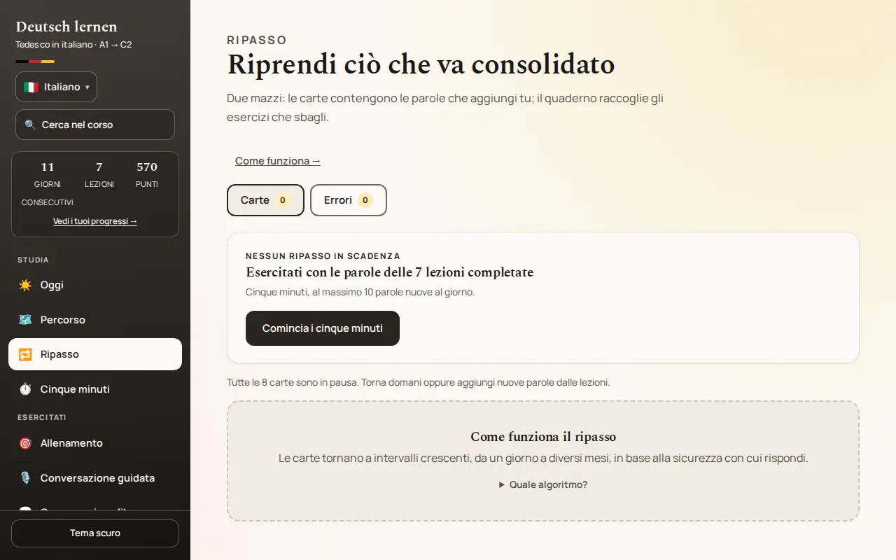

**Ripasso** contiene due mazzi. Il numero accanto alla voce del menu li conta insieme; zero significa che oggi non c'è niente in scadenza, non che hai finito.

- Le **Carte** sono le parole che hai aggiunto con **+ Ripasso**. Vedi il significato, rispondi in tedesco (a mente, ad alta voce o scrivendo), poi ti dai un voto con onestà. Il voto decide quando la carta torna: una parola che sai ricompare sempre più di rado, una che continui a sbagliare torna il giorno dopo. La programmazione usa il metodo FSRS e si calcola dalle tue risposte.
- Gli **Errori** si raccolgono da soli. Ognuno è esattamente l'esercizio che hai sbagliato, con l'etichetta dell'argomento di grammatica, così vedi di che tipo di errore si trattava. Due risposte giuste di fila lo ritirano.

Nelle **Impostazioni**, **Frequenza dei ripassi** ti permette di scambiare meno ripassi con più dimenticanze, o il contrario.

### Cinque minuti

Una sessione di carte che si ferma dopo cinque minuti o venti carte, quale arriva prima. Ogni risposta viene salvata subito, quindi chiudere la scheda a metà non fa perdere nulla. Quando non ci sono carte in scadenza, la sessione usa parole nuove dalle lezioni che hai finito (o dalla prima unità), al massimo dieci parole nuove al giorno. A seconda di quanto conosci una parola, la domanda cambia forma: scegliere il significato, scrivere il tedesco, oppure ascoltare e scegliere o scrivere ciò che hai sentito.

## Esercitati

### Allenamento

Esercizi costruiti da regole invece che da un elenco fisso, quindi non finiscono mai: **Articolo e caso**, **Sein o haben**, **Pronomi complemento**, **Numeri**, **Date**, **Dire l'ora**. Ogni giro ha domande nuove. Gli errori finiscono in **Ripasso**. Se una lezione non entra, fai un giro di Allenamento su quell'argomento invece di ripetere la lezione una terza volta di fila.

### Conversazione guidata

Conversazioni guidate in situazioni reali: il bar, un negozio, la stazione, un colloquio di lavoro. Il corso parla tedesco e tu rispondi nel microfono (**Parla**), oppure scrivi (**…oppure scrivi la risposta**). Alcune conversazioni si biforcano: scegli tu cosa dire. **Mostra la risposta** aiuta quando sei bloccato.

### Conversazione libera

Una conversazione senza copione, condotta da un modello linguistico. Scegli una scena e dici o scrivi la tua parte; l'altra persona risponde in tedesco e, a parte, corregge ciò che vale la pena correggere. Non c'è punteggio. Servono una chiave per un modello e un consenso apposito (vedi [Facoltativo: verifica delle risposte con un modello](#facoltativo-verifica-delle-risposte-con-un-modello)), e una conversazione ha un numero limitato di turni, indicato sullo schermo come **Turni rimasti**. Le sue frasi sono lette dalla voce del dispositivo, perché non sono registrate in anticipo.

### Shadowing

Ascolti una frase, la ripeti, poi senti le due registrazioni una dopo l'altra. Non c'è punteggio: la differenza la senti da te.

### Velocità

La frase parte a velocità naturale, il tedesco che sentirai fuori da un'aula. Puoi rallentarla con un clic quando serve.

### Lettura e ascolto

Letture brevi con domande e, nella biblioteca, testi più lunghi da 400 a 800 parole. Mentre ascolti un testo lungo il corso ricorda a che frase sei arrivato; **Riprendi dalla frase …** ti riporta lì. Toccando una parola si apre una scheda con la forma base e il significato.

### Scrivere in tedesco

Compiti di scrittura con una consegna. Nessuno dà un voto al tuo testo e il corso non finge di farlo: controlla ciò che si può controllare, cioè se hai usato le costruzioni richieste dalla consegna, e mostra un testo modello con cui confrontarti.

### Coppie minime

Due parole che differiscono per un solo suono, per esempio vocale lunga e breve, `ü` e `i`, `ö` ed `e`, oppure `s` e `z` a inizio parola. Ne senti una e scegli quale. Prima si allena l'orecchio; la bocca viene dopo.

### Esame

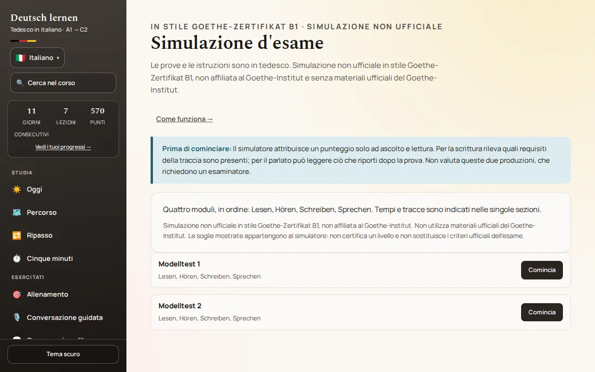

Una simulazione non ufficiale nello stile del Goethe-Zertifikat B1, non affiliata al Goethe-Institut e senza suo materiale. Due prove complete, quattro moduli nell'ordine ufficiale: Lesen (lettura), Hören (ascolto), Schreiben (scrittura), Sprechen (parlato), ciascuno con il suo tempo. Compiti e istruzioni sono in tedesco. Solo lettura e ascolto ricevono un punteggio. La prova scritta torna come elenco delle parti della consegna che hai coperto e di quelle che mancano; la prova orale viene registrata perché tu possa riascoltarti, e dopo scrivi ciò che hai detto. All'esame vero queste due parti le valuta un esaminatore, quindi il simulatore non inventa un voto. Provalo alla fine di un livello, non prima: misura un livello, non lo insegna.

## Consulta

### Grammatica

Il programma completo di grammatica da A1 a C2, ordinato per argomento. Aprilo quando una lezione richiede una spiegazione più ampia.

### Coniugatore

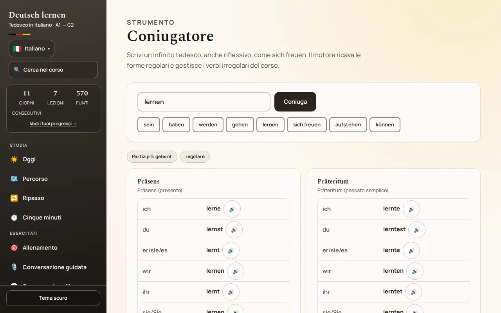

Scrivi un infinito tedesco, anche riflessivo (`sich freuen`), e vedi tutti i tempi: Präsens, Präteritum, Perfekt, Plusquamperfekt, Futur I e II, Konjunktiv I e II, Imperativ. I verbi regolari si ricavano dalle regole; quelli irregolari del corso hanno le loro tabelle.

### Il mio lessico

Tutte le parole che hai aggiunto al ripasso, in ordine di prossima scadenza.

### Falsi amici

Parole che in tedesco significano qualcosa di diverso da ciò che suggerisce la tua lingua. L'elenco dipende dalla lingua delle spiegazioni, perché la trappola dipende dalla lingua che parli già.

### Copertura

Le forme di parole tedesche più frequenti, e quante ne conosci già dalle lezioni. È una misura che puoi verificare fuori dal corso: quanta parte del tedesco di tutti i giorni riconosceresti.

## Il tuo spazio

### Progressi

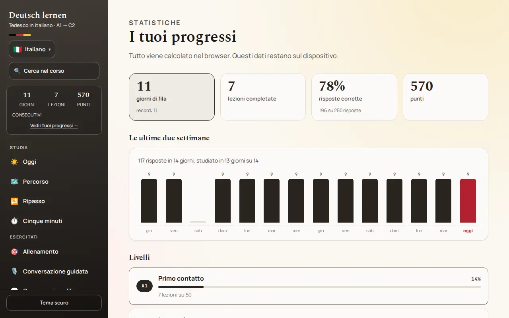

La tua serie (giorni consecutivi con almeno una lezione), le lezioni completate, la percentuale di risposte corrette e i punti, un grafico delle ultime due settimane e una barra per ogni livello. Tutto viene calcolato nel tuo browser.

### Guida al corso

La guida interna al corso: da dove partire, l'ordine sensato e a cosa serve ogni schermata, con un collegamento a ciascuna.

### Impostazioni

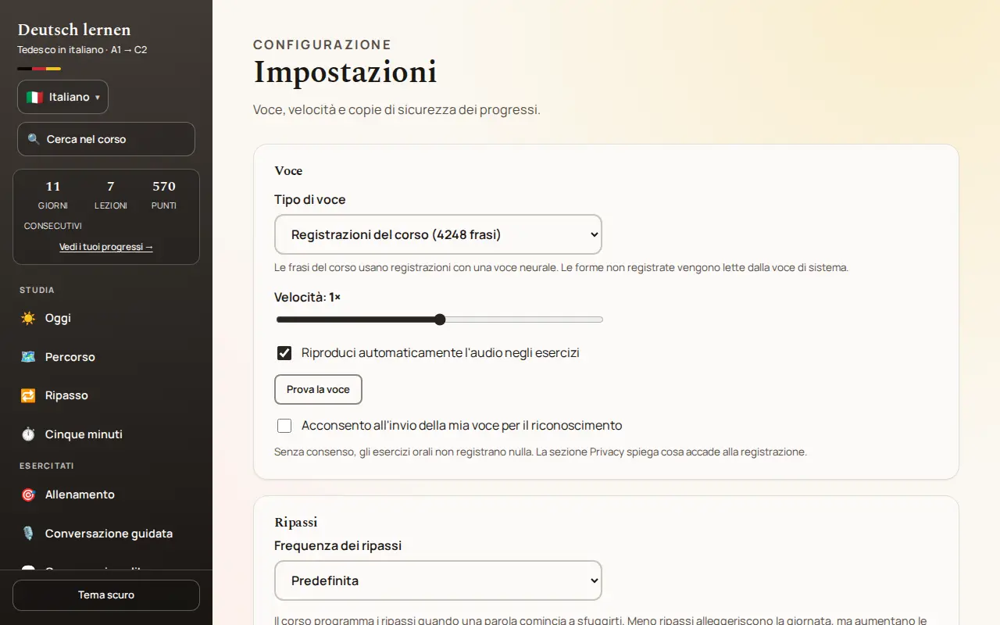

- **Voce**: tipo di voce (registrazioni o voce di sistema), velocità, riproduzione automatica, un pulsante per provare la voce e il consenso al riconoscimento vocale.
- **Verifica delle risposte con un modello**: chiavi, ordine dei fornitori e consenso (vedi sotto).
- **Ripassi**: **Frequenza dei ripassi**.
- **Tornare a studiare**: il contatore sull'icona dell'app, il promemoria per il calendario e il pulsante per installare.
- **Mazzo per Anki**: esportazione e importazione delle carte.
- **Copia di sicurezza dei progressi**: **Esporta**, **Importa**, **Cancella tutto**.
- **Funzioni del browser**: cosa sa fare il tuo browser (sintesi vocale, riconoscimento vocale, uso offline, memoria persistente).
- Da qui puoi anche rifare il test di livello.

## Mettere al sicuro i progressi

Il corso non ha account né sincronizzazione. Tutto ciò che hai imparato sta in questo browser, su questo dispositivo. Se cancelli i dati del sito, o li cancella il browser per conto suo, sono persi.

- **Esporta** in **Impostazioni → Copia di sicurezza dei progressi** scarica un file con tutti i progressi. Conservalo dove vuoi.
- **Importa** carica un file di questo tipo. È anche l'unico modo per portare i progressi su un altro dispositivo o un altro browser.
- Ogni dieci lezioni finite il corso ti ricorda di scaricare una copia. Chiudere il promemoria vuol dire "non ora"; tornerà più avanti.
- Quando hai finito la prima lezione, il corso chiede al browser la **memoria persistente**, che protegge i progressi dalla pulizia automatica. Se hai risposto di no, il browser se lo ricorda.
- **Cancella tutto** elimina tutti i progressi, le carte e le statistiche dopo una conferma. Senza un file di backup non si torna indietro.

Il file di backup non contiene le chiavi API dei modelli.

### Portare le carte in Anki

**Mazzo per Anki → Esporta il mazzo** scrive le tue carte in un formato che leggono Anki, un foglio di calcolo e gli altri programmi di flashcard. Passano solo parole e traduzioni: le scadenze no, quindi in Anki le carte ripartono da zero. **Importa un mazzo** carica un file di questo tipo e, prima di fare qualsiasi cosa, ti dice quante carte aggiungerà, aggiornerà e salterà.

## Uso offline, installazione e promemoria

Dopo la prima visita il corso funziona senza connessione. Le registrazioni vengono conservate man mano che le ascolti, quindi una frase sentita una volta si sente anche offline.

Il corso si può installare come un'app: si apre più in fretta, funziona senza rete e ha la sua icona. Usa **Installa** in **Impostazioni → Tornare a studiare** quando compare. Dove il browser non offre un pulsante di installazione (Firefox, Safari), scegli **Aggiungi alla schermata Home** dal menu del browser; su iPhone si trova nel menu Condividi.

Quando esce una nuova versione, un messaggio te lo segnala. **Aggiorna ora** ricarica il corso con la nuova versione; chiudere il messaggio tiene quella attuale fino alla prossima volta che apri il corso.

Il corso non può mandare notifiche, perché non ha un server da cui inviarle. Per ricordartene ci sono due strumenti:

- **Contatore sull'icona dell'app** mostra quante carte scadono entro un giorno. Parte spento, perché lo vede chiunque guardi il tuo telefono.
- **Scarica il promemoria (.ics)** salva un file che aggiunge al calendario un evento quotidiano all'ora che scegli. Lo togli dal calendario, non dal corso.

Funziona anche aprire `index.html` direttamente dal disco, ma in quel caso il browser non permette l'uso offline, l'installazione e la verifica con un modello.

## Facoltativo: verifica delle risposte con un modello

Il corso confronta le risposte lettera per lettera, quindi può rifiutare una frase corretta ma formulata in modo diverso da quella attesa. Se hai già una chiave API per **Google Gemini**, **Groq**, **OpenAI** o **Anthropic Claude**, puoi chiedere un secondo parere a un modello.

1. Apri **Impostazioni → Verifica delle risposte con un modello**.
2. Incolla la chiave di un fornitore e premi **Prova**. "La chiave funziona." vuol dire che è pronta.
3. Spunta il consenso all'invio delle tue risposte al fornitore scelto.
4. Se aggiungi chiavi di più fornitori, le frecce ne stabiliscono l'ordine: il corso interroga il primo e passa al successivo solo se quello non risponde.

Da quel momento, quando il corso rifiuta una risposta, chiede al modello. Il modello può solo trasformare un rifiuto in un'accettazione, mai segnare come sbagliata una risposta giusta. Vengono inviate solo la tua frase e la risposta attesa. Il numero di richieste per sessione ha un tetto, così un errore non può far salire la spesa. **Elimina tutte le chiavi** rimuove tutte le chiavi da questo dispositivo.

La conversazione libera ha bisogno di un consenso a parte, perché lì viene inviata tutta la conversazione, non una frase sola.

Le chiavi sono salvate sul dispositivo senza cifratura. Su un computer condiviso, eliminale quando hai finito.

## La privacy in breve

- Nessun account, nessuna statistica di utilizzo, nessuna pubblicità, nessun server proprio del corso.
- I progressi restano nel tuo browser.
- Cosa può uscire dal dispositivo: la tua voce, se hai dato il consenso al riconoscimento vocale e usi gli esercizi parlati (va al produttore del browser); le tue risposte o la conversazione, se hai impostato una chiave e dato il consenso (vanno al fornitore scelto); e i dati tecnici che vede chiunque ospiti un sito, come l'indirizzo IP.

L'informativa completa è nel corso alla voce **Privacy**, collegata in fondo a ogni schermata e dalle **Impostazioni**.

## Quando qualcosa non funziona

| Cosa vedi | Cosa fare |
|---|---|
| Gli esercizi parlati non ascoltano | Controlla di aver dato il consenso nelle **Impostazioni** e che il browser possa usare il microfono. Nei browser senza riconoscimento vocale, scrivi la risposta. |
| La voce sembra robotica | Quella frase non ha una registrazione e la sta leggendo la voce del dispositivo. Nelle **Impostazioni**, scegli le registrazioni del corso come tipo di voce. |
| "Quasi! Controlla la grafia" | La risposta differisce solo per la grafia tipo `ae`/`ä` o per le maiuscole. Correggila e verifica di nuovo. |
| Una lezione non entra | Fai un giro di **Allenamento** su quell'argomento e torna alla lezione il giorno dopo. Per la pronuncia usa **Coppie minime** o **Shadowing**. |
| Non trovi una parola o una regola | Usa **Cerca nel corso** in cima alla barra laterale. |
| I progressi sono spariti | Importa l'ultimo file di backup in **Impostazioni → Copia di sicurezza dei progressi**. Senza un file non si recuperano. |
| "Nessuna chiave è stata accettata" | Controlla la chiave nelle **Impostazioni** con **Prova**; potrebbe essere scaduta o senza credito. |
| Un messaggio propone una nuova versione | Premi **Aggiorna ora**. Se lo chiudi, l'aggiornamento aspetta la prossima apertura del corso. |
| L'importazione viene rifiutata | Il file non è un backup di questo corso, è danneggiato, o viene da una versione più recente: ricarica la pagina e riprova. |

---

[Torna al README](../README.it.md)
