**English** | [Italiano](./MANUALE-UTENTE.md)

# Deutsch lernen: user manual

This manual is for people who use the course to learn German. It needs no technical knowledge. Every name in **bold** is the label you see on screen when the course is set to English explanations.

The course lives at <https://andreabonn.github.io/lerne-deutsch/>.

## Contents

- [What you need](#what-you-need)
- [The first launch](#the-first-launch)
- [Finding your way around](#finding-your-way-around)
- [How the course is organised](#how-the-course-is-organised)
- [Inside a lesson](#inside-a-lesson)
- [How answers are checked](#how-answers-are-checked)
- [Audio and your voice](#audio-and-your-voice)
- [Study](#study)
- [Practice](#practice)
- [Look up](#look-up)
- [You](#you)
- [Keeping your progress safe](#keeping-your-progress-safe)
- [Offline use, installing and reminders](#offline-use-installing-and-reminders)
- [Optional: answer checking by a model](#optional-answer-checking-by-a-model)
- [Privacy in short](#privacy-in-short)
- [When something does not work](#when-something-does-not-work)

## What you need

- A recent browser on a computer, tablet or phone. Chrome, Edge and Safari 16 or later support every feature, including speaking exercises. Other browsers run the whole course; where speech recognition is missing, the speaking exercises switch to typing.
- Headphones or speakers for the audio.
- A microphone, only for the speaking exercises.

There is no account to create and nothing to pay. Your progress is saved in the browser you are using, on the device you are using.

## The first launch

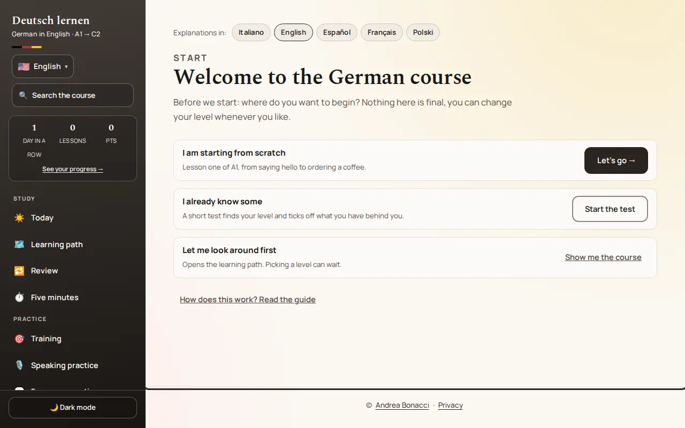

The first time you open the course you see three choices:

- **I am starting from scratch** opens lesson one of A1, from saying hello to ordering a coffee.
- **I already know some** starts a short placement test. It has about 18 items in three rounds and jumps between levels instead of walking through them, so it ends quickly. At the end it proposes a level: **Start at …** marks the lessons of the levels below as done (without points, because you did not do them), while **I would rather start from the beginning** keeps everything open. You can retake the test later from **Settings**.
- **Let me look around first** opens the learning path without choosing anything.

At the top of the welcome screen you choose the **explanation language**: Italiano, English, Español, Français or Polski. German is always the language you learn; this choice only changes the language of explanations, translations and the interface. You can change it at any time with the language button at the top of the sidebar, and your progress stays the same.

## Finding your way around

On a computer the sidebar on the left holds everything. At the top: the course name, the language button, **Search the course**, and a box with three numbers (days in a row, lessons, points) that opens **Progress**. Below come four groups of screens: **Study**, **Practice**, **Look up** and **You**. At the bottom, **Dark mode** switches the colour theme.

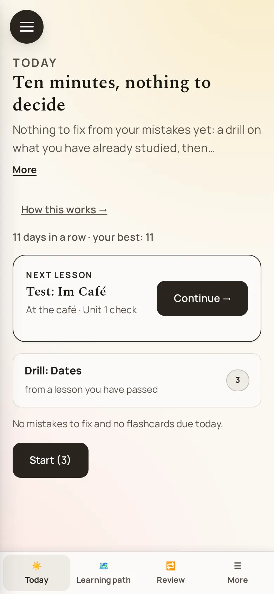

On a phone the sidebar is hidden. A bar at the bottom of the screen gives you **Today**, **Learning path** and **Review**; **More** opens the full menu.

**Search the course** looks through lesson titles, vocabulary, grammar entries and conversations, in German or in your language, with or without accents and umlauts.

## How the course is organised

The course runs from A1 to C2, the six levels of the Common European Framework. Each level is divided into units, and each unit into lessons. The last item of a unit is a test that covers the whole unit, not only the last lesson.

The grammar is cumulative: A2 assumes you know A1, B1 assumes A2. Nothing stops you from opening a later lesson, but from that point on the lessons stop explaining what came before.

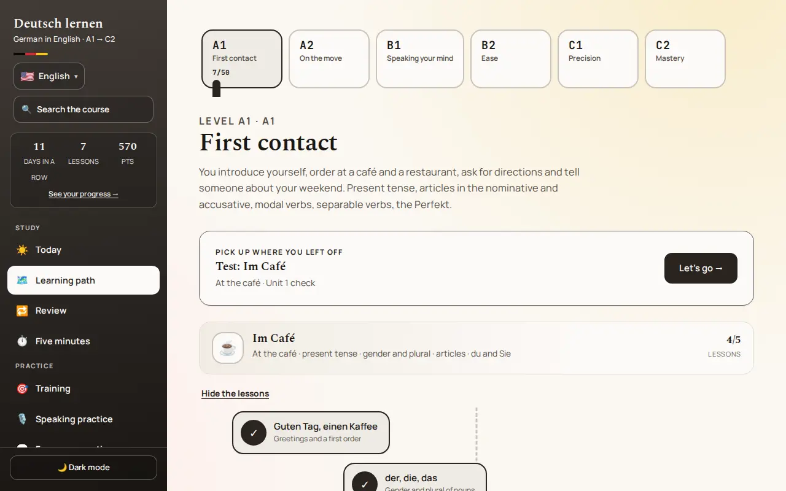

**Learning path** shows every level, unit and lesson, with your progress on each. A ticked lesson is passed. A box at the top shows the next lesson to do, with a button to open it.

## Inside a lesson

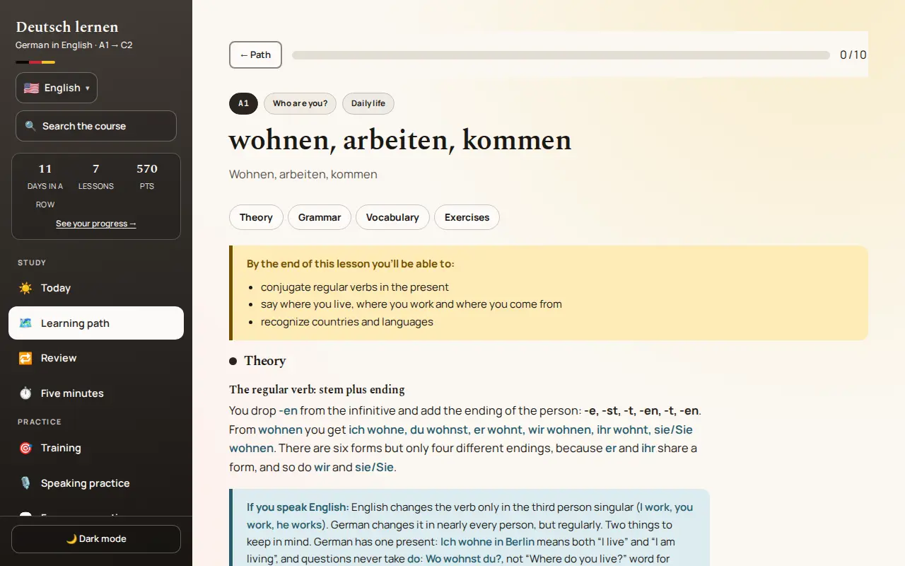

Every lesson has the same parts, reachable from the buttons under the title: **Theory**, **Grammar**, **Vocabulary**, **Exercises**, plus a dialogue and a culture note.

- **Theory** explains the topic. The blue boxes compare German with your explanation language: they are written separately for each language, because the difficulty for an Italian speaker is not the one for a Polish or an English speaker.
- **Grammar** has a table and examples. The theory stays on the page, so you can scroll back to it while you do the exercises.
- **Vocabulary** lists the words of the lesson with their translation and an example. The speaker button plays the word. **+ Review** adds a word to your review deck; **Add all to review** adds every word of the lesson at once.
- **Exercises** come at the end, numbered at the top so you can see how many are left.

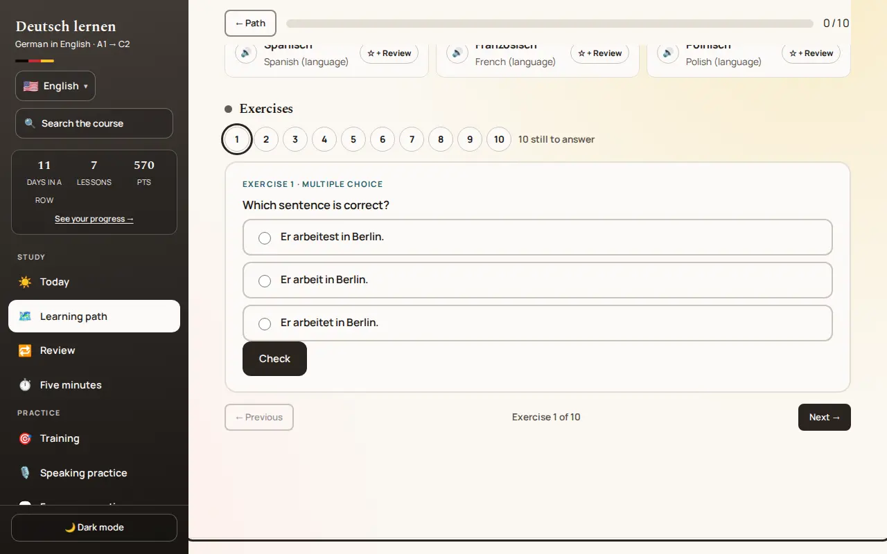

Answer and press **Check**. **Next** and **Previous** move between exercises. A lesson counts as passed from **70 percent** of correct answers. Below that it stays open and you can take it again: nothing is lost, and the score starts over.

Every wrong answer opens a card in the mistake notebook, which comes back to you under **Review**. You do not need to write anything down.

### The exercise types

| On screen | What you do |
|---|---|
| multiple choice | pick the right answer |
| pick several | select every correct answer |
| true / false | decide whether a statement about a text is true (in readings) |
| matching | match German phrases with their meanings |
| articles | pick `der`, `die` or `das`, or the article in the right case |
| minimal pair | hear one of two similar words and say which one it was |
| fill the gap | type the missing word |
| fill the text | fill several gaps in a short text |
| translation | translate into German or from German |
| build the sentence | put the word tiles in the right order |
| conjugation | write the forms of a verb in a given tense |
| listening | listen and write what you hear |
| pronunciation | read a sentence aloud into the microphone |
| conversation | answer your part in a short dialogue |

## How answers are checked

The course compares what you type with the expected answer.

- A capital letter at the start of a sentence is not required.
- Writing `ae`, `oe`, `ue` or `ss` instead of `ä`, `ö`, `ü` or `ß`, or a noun in lower case (`die strasse` for `die Straße`), counts as **almost right**: you get the message to check the spelling and can try again.
- A **missing umlaut is a mistake**. `Madchen` is not `Mädchen`, just as `schon` is not `schön`. Type the umlaut, or use the transcription above.
- Where a synthetic Konjunktiv II form exists (`stünde`, `führe`), it is accepted even if the table shows the form with `würde`.

### Typing German characters

When a field expects German, a row of buttons under it inserts `ä ö ü ß Ä Ö Ü`. On a phone you can also hold the vowel on the keyboard.

## Audio and your voice

The sentences of the course are recordings made with two neural German voices: one for the main speaker and one for the other person in dialogues and conversations. Forms that are not in the recordings (for example some forms in the verb conjugator) are read by your device's own voice, which can sound mechanical, especially on Linux.

In **Settings** you can choose the voice source, the speech rate and whether recordings play automatically in exercises.

The speaking exercises use the speech recognition built into your browser. In Chrome and Edge the browser sends your voice to its maker's servers to turn it into text; this is why the course asks your consent before the first recording. Without consent the speaking exercises record nothing and you can type instead. You can withdraw the consent in **Settings** at any time.

## Study

### Today

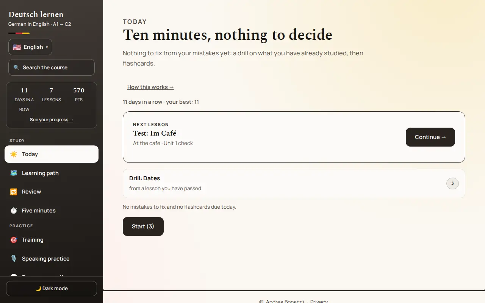

**Today** builds a ten-minute session for you: your mistakes first, then a drill on the topic that is going worst, then the cards that are due. It also shows the next lesson with a **Continue** button. Use it on days when you do not want to decide what to study. The session always has something in it, because the generated drills never run out.

### Learning path

All levels, units and lessons. See [How the course is organised](#how-the-course-is-organised).

### Review

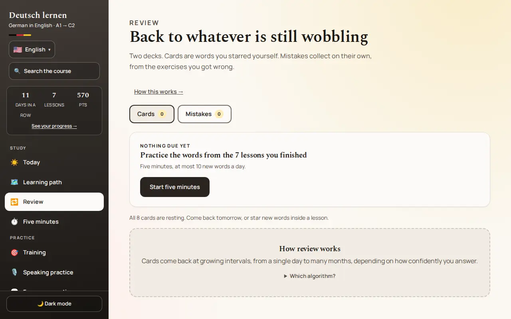

**Review** holds two decks. The badge on the menu item counts both together; zero means nothing is due today, not that you have finished.

- **Cards** are the words you added with **+ Review**. You see the meaning, answer in German (in your head, aloud or by typing), then grade yourself honestly. The grade decides when the card comes back: a word you know returns less and less often, a word you keep missing comes back the next day. The schedule uses the FSRS method and is computed from your answers.
- **Mistakes** collect on their own. Each one is the exact exercise you got wrong, labelled with its grammar topic, so you can see what kind of mistake it was. Two correct answers in a row retire it.

In **Settings**, **How often cards come back** lets you trade fewer reviews for more forgetting, or the other way round.

### Five minutes

A card session that stops after five minutes or twenty cards, whichever comes first. Every answer is saved at once, so closing the tab halfway loses nothing. When no card is due, the session uses new words from lessons you have finished (or from the first unit), at most ten new words a day. Depending on how well you know a word it is asked in different ways: pick the meaning, write the German, or listen and pick or write what you heard.

## Practice

### Training

Exercises built from rules rather than from a fixed list, so they never run out: **Article and case**, **Sein or haben**, **Object pronouns**, **Numbers**, **Dates**, **Telling the time**. Every round has new items. Mistakes go to **Review**. If a lesson does not sink in, do a Training round on that topic instead of repeating the lesson a third time in a row.

### Speaking practice

Guided conversations in real situations: the bar, a shop, the station, a job interview. The course speaks German and you answer into the microphone (**Speak**), or type (**…or type your answer**). Some conversations fork: you pick what you want to say. **Show the answer** helps when you are stuck.

### Free conversation

A conversation with no script, run by a language model. You pick a scene and say or type your piece; the other person answers in German and, separately, corrects what is worth correcting. Nothing is scored. It needs a model key and its own consent (see [Optional: answer checking by a model](#optional-answer-checking-by-a-model)), and a conversation has a limited number of turns, shown on screen as **Turns left**. Its sentences are read by your device's voice, because they are not recorded in advance.

### Shadowing

Listen to a sentence, say it back, then hear both recordings one after the other. Nothing is scored: you hear the difference yourself.

### Speed

The sentence plays at natural speed first, the German you will hear outside a classroom. You can slow it down with one click when you need to.

### Reading and listening

Short readings with questions, and from the library longer texts of 400 to 800 words. While you listen to a long text the course remembers the sentence you reached; **Resume from sentence …** takes you back there. Tapping a word opens a card with its dictionary form and meaning.

### Writing in German

Writing tasks with a brief. Nobody grades your text and the course does not pretend to: it checks what can be checked, that is whether you used the constructions the task asks for, and shows a model text to compare with.

### Minimal pairs

Two words that differ by one sound, for example a long and a short vowel, `ü` and `i`, `ö` and `e`, or `s` and `z` at the start of a word. You hear one and choose which. Train the ear first; the mouth follows.

### Exam

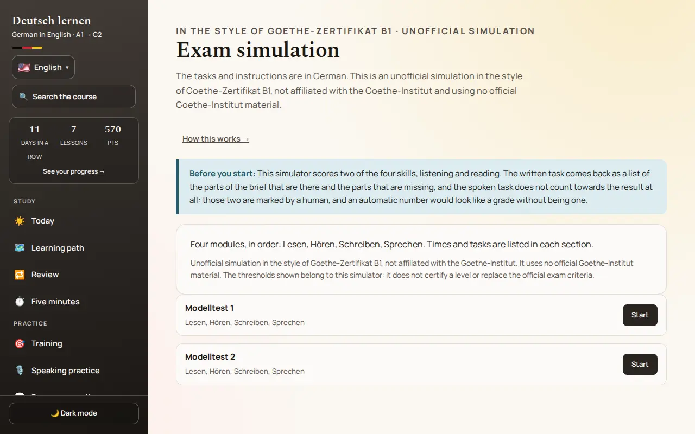

An unofficial simulation in the style of Goethe-Zertifikat B1, not affiliated with the Goethe-Institut and using none of its material. Two model tests, four modules in the official order: Lesen (reading), Hören (listening), Schreiben (writing), Sprechen (speaking), each with its own time limit. The tasks and instructions are in German. Only reading and listening get a score. The written task comes back as a list of the parts of the brief you covered and the ones you missed; the spoken task is recorded so you can listen to yourself, and you write down afterwards what you said. A real examiner marks those two parts, so the simulator does not invent a grade for them. Try it at the end of a level, not before: it measures a level, it does not teach one.

## Look up

### Grammar

The full grammar syllabus from A1 to C2, arranged by topic. Open it when a lesson needs a wider explanation.

### Verb conjugator

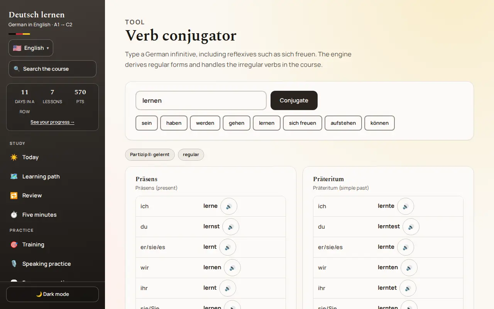

Type a German infinitive, reflexives included (`sich freuen`), and see every tense: Präsens, Präteritum, Perfekt, Plusquamperfekt, Futur I and II, Konjunktiv I and II, Imperativ. Regular verbs are derived by rule; the irregular verbs of the course have their own tables.

### My vocabulary

Every word you added to review, sorted by when it is next due.

### False friends

Words that mean something different in German from what your language suggests. The list depends on your explanation language, because the trap depends on the language you already speak.

### Coverage

The most frequent German word forms, and how many of them you already know from your lessons. It is a measure you can check outside the course: how much of everyday German you would recognise.

## You

### Progress

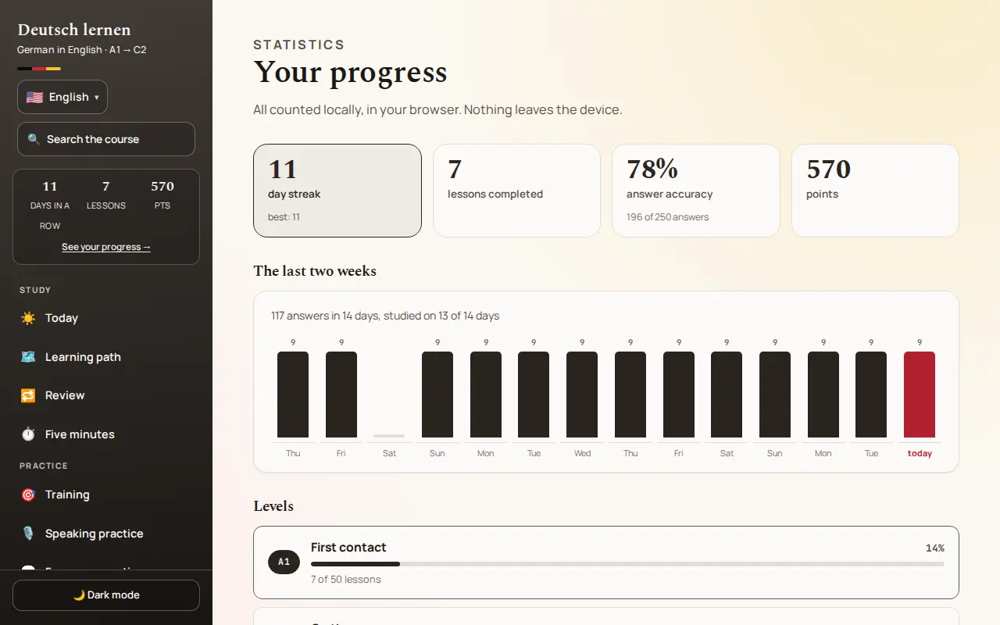

Your streak (days in a row with at least one lesson), lessons completed, answer accuracy and points, a chart of the last two weeks and a bar for each level. Everything is counted in your browser.

### How to use it

The guide inside the course: where to start, the order that makes sense, and what each screen is for, with a link to each one.

### Settings

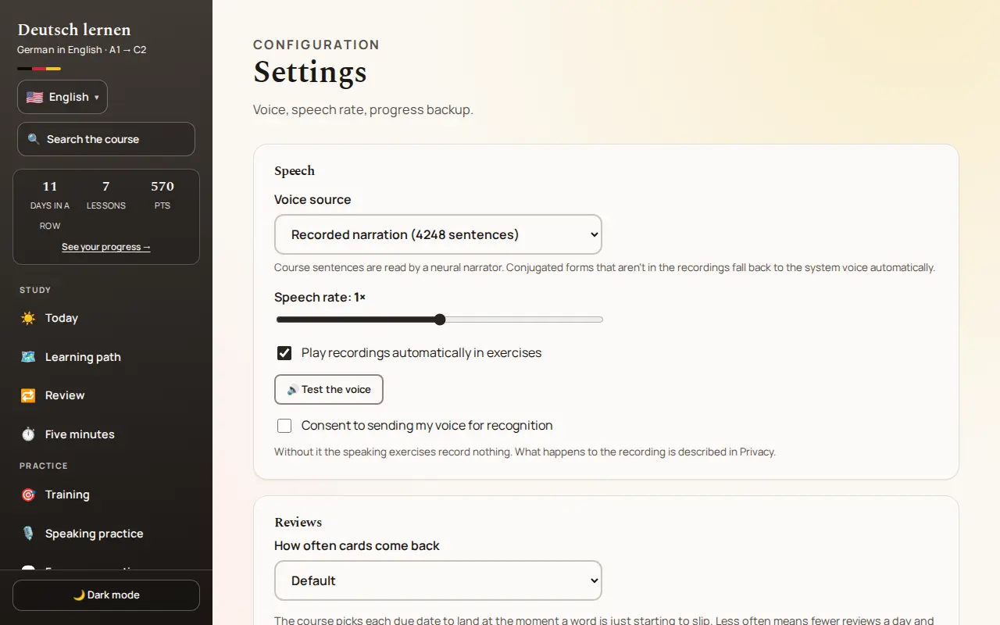

- **Speech**: voice source (recordings or the system voice), speech rate, automatic playback, a button to test the voice, and the consent for speech recognition.
- **Answer checking by a model**: keys, provider order and consent (see below).
- **Reviews**: **How often cards come back**.
- **Coming back**: the count on the app icon, the calendar reminder and the install button.
- **Deck for Anki**: export and import of your cards.
- **Progress backup**: **Export**, **Import**, **Erase everything**.
- **Browser support**: what your browser can do (synthesis, speech recognition, offline mode, permanent storage).
- The placement test can be taken again from here.

## Keeping your progress safe

The course has no account and no sync. Everything you have learned sits in this browser on this device. If you clear the site data, or the browser clears it for you, it is gone.

- **Export** in **Settings → Progress backup** downloads a file with all your progress. Keep it wherever you like.
- **Import** loads such a file. It is also the only way to move your progress to another device or another browser.
- Every ten finished lessons the course reminds you to download a copy. Closing the reminder means "not now"; it comes back later.
- When you have finished your first lesson, the course asks the browser for **permanent storage**, which protects your progress from automatic clean-up. If you answered no, the browser remembers that.
- **Erase everything** deletes all progress, cards and statistics after a confirmation. It cannot be undone without a backup file.

The backup file does not contain your model API keys.

### Taking your cards to Anki

**Deck for Anki → Export deck** writes your cards in a format that Anki, a spreadsheet and other flashcard programs can read. Only words and translations travel: the review dates do not, so in Anki the cards start from zero. **Load a deck** imports such a file and tells you how many cards it will add, update and skip before it does anything.

## Offline use, installing and reminders

After the first visit the course works without an internet connection. Recordings are stored as you listen to them, so a sentence you have heard once plays offline.

The course can be installed like an app: it opens faster, works without a network and gets its own icon. Use **Install** in **Settings → Coming back** when it appears. Where the browser offers no install button (Firefox, Safari), use **Add to Home Screen** from the browser menu; on iPhone it is in the share menu.

When a new version is published, a message tells you so. **Update now** reloads the course with the new version; closing the message keeps the current one until the next time you open the course.

The course cannot send notifications, because it has no server to send them from. Two things can bring you back instead:

- **Count on the app icon** shows how many cards are due within a day. It starts switched off, because anyone who glances at your phone sees it.
- **Download reminder (.ics)** saves a file that adds a daily event to your calendar at the time you choose. You remove it in your calendar, not in the course.

Opening `index.html` straight from your disk also works, but then the browser does not allow offline storage, installing or the model check.

## Optional: answer checking by a model

The course compares answers letter by letter, so it can reject a sentence that is correct but worded differently from the expected one. If you already have an API key for **Google Gemini**, **Groq**, **OpenAI** or **Anthropic Claude**, you can ask a model for a second opinion.

1. Open **Settings → Answer checking by a model**.
2. Paste your key for one provider and press **Try it**. "The key works." means it is ready.
3. Tick the consent to send your answers to the provider you chose.
4. If you add keys for several providers, the arrows set the order: the course asks the first one and moves to the next only when it fails.

From then on, when the course rejects an answer, it asks the model. The model can only turn a rejection into an acceptance, never mark a correct answer wrong. Only your sentence and the expected answer are sent. The number of requests per session is capped, so a mistake cannot run up your bill. **Delete every key** removes all keys from this device.

Free conversation needs its own consent, because there the whole conversation is sent, not a single sentence.

Keys are stored on your device without encryption. On a shared computer, delete them when you are done.

## Privacy in short

- No account, no analytics, no advertising, no server of the course's own.
- Your progress stays in your browser.
- What can leave your device: your voice, if you consented to speech recognition and use the speaking exercises (it goes to your browser's maker); your answers or conversation, if you set up a model key and consented (they go to the provider you chose); and the technical data any website host sees, such as your IP address.

The full notice is in the course under **Privacy**, linked at the bottom of every screen and from **Settings**.

## When something does not work

| What you see | What to do |
|---|---|
| The speaking exercises do not listen | Check that you gave consent in **Settings** and that the browser may use the microphone. In browsers without speech recognition, type your answer. |
| The voice sounds robotic | That sentence has no recording and your device's voice is reading it. In **Settings**, choose recorded narration as voice source. |
| "Almost! Check the spelling" | Your answer differs only in `ae`/`ä`-type spelling or capital letters. Correct it and check again. |
| A lesson will not stick | Do a **Training** round on that topic, come back to the lesson the next day. For pronunciation, use **Minimal pairs** or **Shadowing**. |
| You cannot find a word or rule | Use **Search the course** at the top of the sidebar. |
| Your progress is gone | Import your last backup file in **Settings → Progress backup**. Without a file it cannot be recovered. |
| "None of your keys was accepted" | Check the key in **Settings** with **Try it**; it may have expired or have no credit left. |
| A message offers a new version | Press **Update now**. If you close it, the update waits until the next time you open the course. |
| The import is refused | The file is not a backup of this course, is damaged, or comes from a newer version: reload the page and try again. |

---

[Back to README](../README.md)
